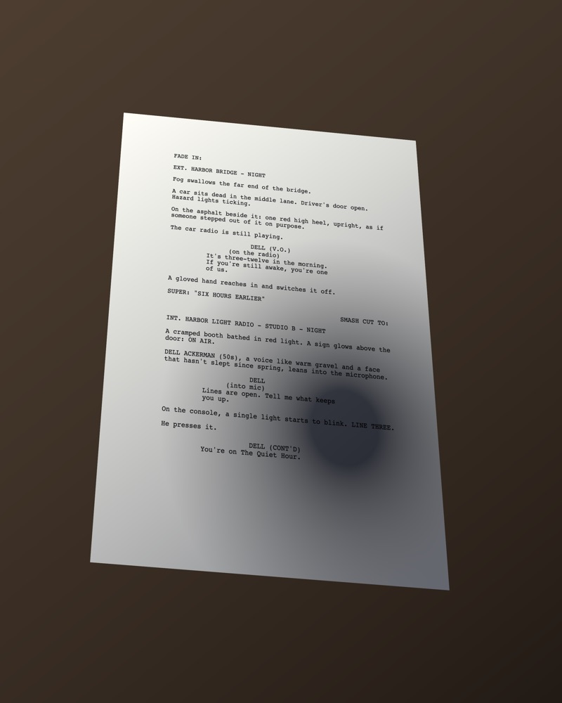
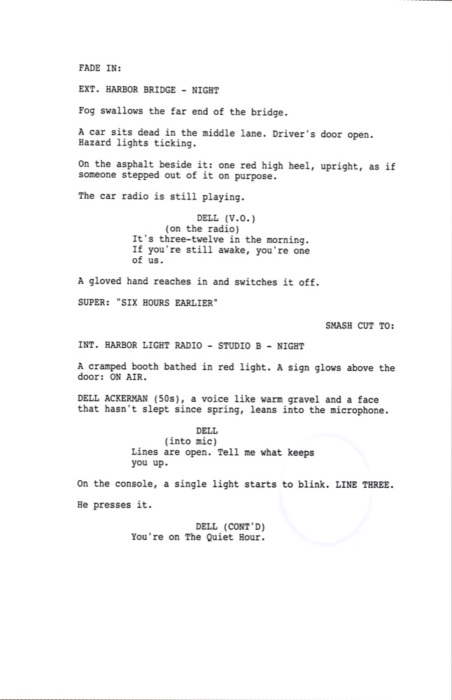
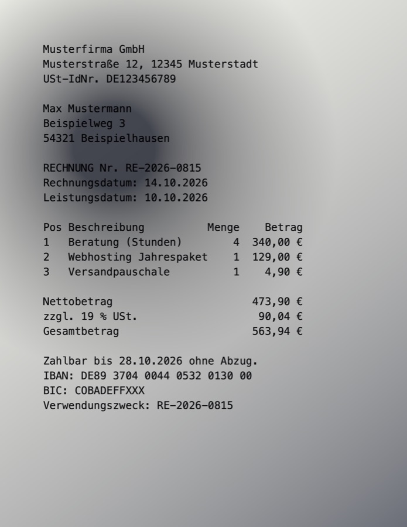
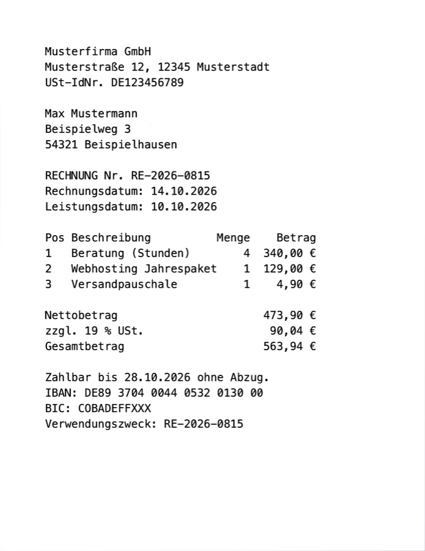

# Scanner

[](https://github.com/Yasirdora/scanner/actions/workflows/ci.yml)

An on-device document scanner for iPhone. A Swift package turns a photo of a
page into a clean, searchable PDF, and a SwiftUI app is built on top of it.

Everything runs on the device. The engine has no network code and no
third-party code dependencies. It also builds for macOS, so the whole pipeline
can be run, measured and tested from the command line, without a simulator.

<table>
<tr>
<td></td>
<td></td>
</tr>
<tr>
<td align="center"><em>Rendered on a table</em></td>
<td align="center"><em>Found, straightened, cleaned up</em></td>
</tr>
</table>

*The first page of an invented screenplay, rendered lying on a table, and
what the scanner made of it. Generated with
`scanlab synth --document screenplay --on-table`, so every word on it is known.*

## What it does

| Step | Module | How |
|---|---|---|
| Find the page | `ScanCapture` | Vision's document segmenter on every frame, and a slower candidate scorer that also finds small items. A tracker decides which answer to trust. |
| Capture | `ScanCapture` | Auto-capture fires once when the page holds still, then waits until the page changes. |
| Flatten | `ScanEnhance` | Perspective correction from the same four corners the viewfinder showed. |
| Clean up | `ScanEnhance` | Flat-field lighting correction, document tone mapping and Otsu binarisation, in Core Image. |
| Read | `ScanRecognize` | Vision's `RecognizeDocumentsRequest`: text with positions, tables, detected values and barcodes. |
| Export | `ScanExport` | A PDF with an invisible, selectable text layer that sits on the ink. |
| Extract | `ScanExtract` | Typed fields and a title from the on-device Foundation Models model, when the device has one. |

## Use it

```swift
import ScanEngine

let scanner = DocumentScanner()
let page = try await scanner.scan(photo)        // a CGImage
print(page.text)                                // the text, in reading order
try scanner.exportPDF([page], to: url, title: "Receipt")
```

`DocumentScanner` finds the page, straightens it, cleans it up and reads it.
A screenshot or a flat scan, where the page fills the whole image, comes back
whole. To skip page finding for such images, use
`DocumentScanner(options: .init(findsPage: false))`.

- [`Examples/QuickStart`](Examples/QuickStart) — a small SwiftUI app: pick a
  photo or try the bundled German sample bill, see the text and the data found
  in it, share the PDF.
- [Documentation](Sources/ScanEngine/ScanEngine.docc) — Getting Started and
  one article per step, built with DocC.

## Reading a German bill

A fictional invoice from "Musterfirma GmbH", made with
`scanlab synth --document invoice --on-table`, so every word on it is known.

<table>
<tr>
<td></td>
<td></td>
<td></td>
</tr>
<tr>
<td align="center"><em>As shot</em></td>
<td align="center"><em>Auto</em></td>
<td align="center"><em>Ink</em></td>
</tr>
</table>

*The same bill lying flat, with a hand's shadow over the address, rendered
with `scanlab synth --document invoice --shadow 0.28,0.72`: as shot, after
Auto (which chose Colour), and in Ink, the smallest file. Made with
`scanlab process --style original|auto|bitonal`.*

With German set as the language, the scanner reads 97.1% of its words and
finds these as data:

| Field | Found |
|---|---|
| Total (Gesamtbetrag) | `EUR 563.94` |
| IBAN, check digits verified | `DE89 3704 0044 0532 0130 00` |
| Invoice date | 14.10.2026 |
| Due date ("Zahlbar bis") | 28.10.2026 |
| Addresses | sender and recipient |

```swift
var options = DocumentScanner.Options()
options.recognition.languages = [Locale.Language(identifier: "de-DE")]
let page = try await DocumentScanner(options: options).scan(photo)
page.recognition.detected   // amounts, dates, addresses, IBANs
```

Vision does not report IBANs, so the engine finds them itself. It keeps only
those that fit their country's format in the IBAN registry (a German IBAN is
"DE", two check digits and 18 digits) and whose ISO 13616 check digits hold.
Together, the two catch every single misread character in a German IBAN, and
every character lost or doubled, but not every mistake (see Known limits). [eDraft](https://apps.apple.com/app/edraft/id6816992261), my
screenwriting app on the App Store, scans paper scripts with the same Vision
document recognition and the same invisible PDF text layer.

One thing Vision gets wrong here is kept visible as a known-issue test: on
the flat bill, data detection reads the quantity and the amount "4  340,00 €"
as one number, 4340 €. The text itself is right.

## Measured, not guessed

`scanlab compare` runs every enhancement style through the recogniser and
scores it against the ground truth. CER is the character error rate: lower is
better, 0 means every character is right.

Measured with Xcode 27.0 on an Apple silicon Mac, with page finding off. On
this ~350-character receipt, 0.006 is about two wrong characters.

| Test page | Auto (default) | Photo as shot | Ink file vs photo |
|---|---|---|---|
| Ordinary receipt | 0.006 | 0.017 | 108 KB vs 1199 KB |
| Clean receipt | 0.006 | 0.017 | 107 KB vs 499 KB |
| Heavy shadow | 0.023 | **0.011** | 123 KB vs 1385 KB |
| Heavy shadow, 4K | 0.020 | 0.017 | 501 KB vs 4115 KB |

What this shows:

- On ordinary pages, the cleaned-up page reads about three times better than
  the photo.
- On the heavy-shadow pages, the photo as shot now reads *better* than the
  style Auto picks. Apple's recogniser seems to have improved: with Xcode 26.6,
  a third of the characters on this page were wrong before cleanup. Closing
  this gap is open work.
- Ink files are 4 to 11 times smaller than the photo.

`AccuracyTests` pins every page in every style, so a change in either
direction fails the build.

## Tests

118 tests (Swift Testing) cover the engine. One of them runs only on machines
without the on-device model, such as CI. Some of them, by name:

- *Every known page reads within its error limit, in every style* (28 cases)
- *A page photographed at an angle is found, straightened and read*
- *Ink is the smallest style, and at least four times smaller than the photo*
- *A page held steady is captured exactly once, however long it is held*
- *Lifting the phone away and returning captures the next page*
- *The small printed item wins over the sheet it rests on*
- *The PDF text layer is selectable and correctly ordered* (read back with PDFKit)
- *A page with no text is refused before the model is asked*

CI runs them on every push. Vision's recogniser and page detectors do not run
on GitHub's virtual Macs: every request fails there with `unknownError`. So on
CI, the tests that need Vision are skipped with that reason; on a real Mac
nothing is skipped, and every test runs before each commit. CI also builds the
app and the QuickStart example for the iOS Simulator, and builds the
documentation.

## Requirements

- Xcode 27 (built and tested with Xcode 27.0 and Swift 6.4)
- iOS 26 or macOS 26
- The camera needs a real iPhone. In the simulator, import a photo instead.
- Field extraction needs a device with Apple Intelligence. Everything else
  works without it.

## Build and run

The engine and its command-line tool:

```bash
swift build
swift test
swift run scanlab synth /tmp/page.png --difficulty hard   # a page and its transcript
swift run scanlab compare /tmp/page.png                   # score every style
swift run scanlab auto Fixtures/real/7794.png --out /tmp/scan   # photo → searchable PDF
```

`swift run scanlab` with no arguments lists every command.

The app: open `Scanner.xcodeproj` and run the **Scanner** scheme. The project
is generated from `project.yml` with [XcodeGen](https://github.com/yonaskolb/XcodeGen)
(`xcodegen generate`).

The example: open `Examples/QuickStart/QuickStart.xcodeproj` and run the
**QuickStart** scheme.

The documentation: in Xcode, choose Product > Build Documentation, or run

```bash
xcodebuild docbuild -scheme ScanEngine -destination 'generic/platform=macOS'
```

## Layout

```
Sources/
  ScanEngine      DocumentScanner: the one call, plus the DocC catalog
  ScanCore        value types, options, accuracy metrics
  ScanCapture     detection, candidate scoring, tracking, auto-capture rules
  ScanEnhance     perspective, lighting correction, tone, binarisation
  ScanRecognize   Vision document recognition → positioned text
  ScanExport      searchable PDF (Core Graphics + Core Text)
  ScanExtract     DocumentExtracting protocol + Foundation Models implementation
  scanlab         command-line harness
App/              SwiftUI iPhone app: camera, corner editor, page viewer
Examples/         QuickStart: the smallest app that uses ScanEngine
Tests/            Swift Testing suites
Fixtures/         test pages, ground-truth transcripts, sample outputs
Docs/images/      README images, made with scanlab synth, auto and process
```

## Design notes

- **Two detectors, one tracker.** Vision's segmenter takes 3–6 ms, fast enough
  for every frame, but it finds nothing when a small card lies on a larger
  sheet. The candidate scorer finds the card, but takes 144–235 ms (measured
  on a Mac), too slow for every frame. `DocumentTracker` holds both answers:
  it trusts the precise one only while it is fresh and the scene still
  matches, and the fast one otherwise. It is pure and synchronous, so every
  rule has a test.
- **A seen outline beats a guess from the print.** The page finder also
  guesses the page from its print: the block of text plus a margin. That is
  how it finds a white card on white paper. On a page photographed on a
  table, the guess ran onto the table on one side and cut blank paper on the
  other. Now an outline seen in the photo wins when it holds all the print
  and the guess covers at least half of it. The angle photo keeps 0.367 of
  the photo instead of 0.233, at the same error rate (0.0115). The sheet
  under a card holds the card's print too, but the guess covers less than a
  third of it, so the card still wins.
- **White point from the paper, not from a percentile.** A percentile moves
  with how much ink is on the page, so the same paper came out a different
  grey on every page. Taking the most common paper value fixed that. It also
  made colour pages much smaller: the same page went from 3548 KB before the
  fix to 566 KB today.
- **Thresholds the tests caught.** The first auto-capture drift limit, 0.012
  per frame, turned out to be a deliberate hand movement, not a tremor. It is
  now 0.0035, and 16 stabiliser tests cover the capture rules.
- **A real text layer.** Text is drawn in `CGTextDrawingMode.invisible`
  (PDF `Tr 3`), not with a transparent fill, which some viewers and printers
  still paint. Each run's font size is fitted to its own box, so a selection
  lands on the ink.

## Known limits

- Vision's data detection can read a quantity printed next to an amount as part
  of the amount ("4  340,00 €" as 4340 €).
- The IBAN check does not catch every misread. About 1 in 105 IBANs with two
  misread digits still pass. In 38 of the registry's 89 countries, part of
  the account number may hold letters as well as digits. In four of them the
  engine also tests a national check: the RIB key in France and Monaco, the
  CIN in Italy and San Marino. There, about 1 in 1,000 (France, Monaco) and
  1 in 2,400 (Italy, San Marino) digits read as a letter still pass, among
  them "1" as "J" in France and "6" as "G" in Italy. In the other 34,
  Switzerland among them, about 1 in 100 still pass ("5" as "S"). Show a
  found IBAN to the user before paying.
- The RIB key and the CIN follow the rules that bank calculators use; the
  French and Italian banking associations publish no text of them online.
  SWIFT's example IBANs for the four countries fit them. If a rule were
  wrong, a real IBAN from these countries would be missing, but a wrong one
  would still not be reported.
- IBANs are checked against SWIFT's IBAN registry of 17 September 2026. An
  IBAN from a country added to the registry later is not found.
- On a flat page with a picture or a logo away from its text, the page finder
  can still keep only part of the page. With a logo in a corner of the
  ordinary receipt, it kept the text and lost the logo. Turn page finding off
  for such images.
- On a page lying on a table with little print, where the print and its
  margin cover less than half the page, the page finder keeps only the part
  around the print. A card whose border cannot be seen looks the same in a
  photo, and there the card is the right answer.
- On a very busy machine, Vision's model runtime sometimes fails a request.
  When it fails with `e5rt_stream_completion_handler call failed`, the engine
  runs the request again, up to twice. Any other failure is passed on at once.
  One of them, seen under load in another project, took about 15 seconds and
  failed again on every retry.
- The app does not use the live tracker and auto-capture rules yet; they are
  tested engine features.
- Curved pages, such as an open book, are not flattened. Only perspective is
  corrected.
- The auto-capture limits come from reasoning about hand tremor, not from
  measurements in the field.
- The accuracy tests use synthetic pages only. Three real photos in
  `Fixtures/real` have no transcript; `scanlab` and one page-finding test use
  them. Real photos are much harder: on five phone photos of a German thermal
  receipt (kept private, not in this repo), 6–18% of the characters were
  wrong, against 1–2% on the synthetic pages. A real test set is the most
  useful next step.
- On the heavy-shadow test page, cleanup now reads slightly worse than the
  photo as shot (see the table above).
- In very deep shadow, where the lighting estimate is near zero, banding can
  appear.

## License

MIT — see [LICENSE](LICENSE).
